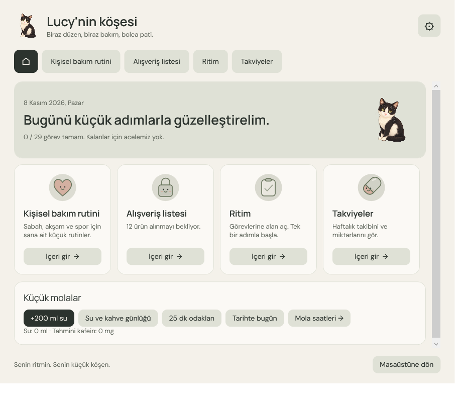
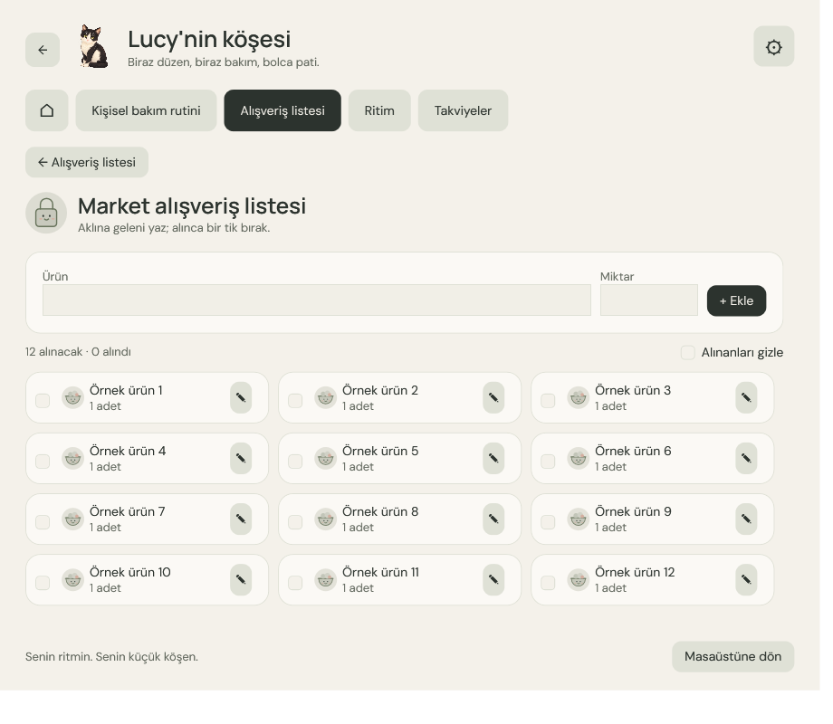

# Lucy 🐾

  
  
  

**Masaüstünde küçük bir dost, gününde sana ait bir köşe.**

Lucy; hatırlatmalarını, rutinlerini, alışveriş listelerini ve günlük takibini bir araya getiren animasyonlu bir Windows masaüstü arkadaşıdır.

## Lucy'nin köşesi

*Görseller uygulamanın test modunda, örnek verilerle hazırlanmıştır.*

## Başlarken

1. Depoyu indir, dosyaları aynı klasöre çıkar ve `Lucy.exe` dosyasını aç. Windows ve .NET Framework 4.7.2 veya üzeri gereklidir.
2. İstersen kısayollar için `./Kur.ps1`, kaynak koddan derlemek için `./Derle.ps1` komutunu PowerShell'de çalıştır.

İlk açılışta boş bir profil oluşur. Kayıtlar `data`, raporlar `Raporlar` klasöründe yerel olarak saklanır ve Git dışında tutulur. Daha fazlası için [kullanım rehberine](Beni%20oku.md) bakabilirsin.
