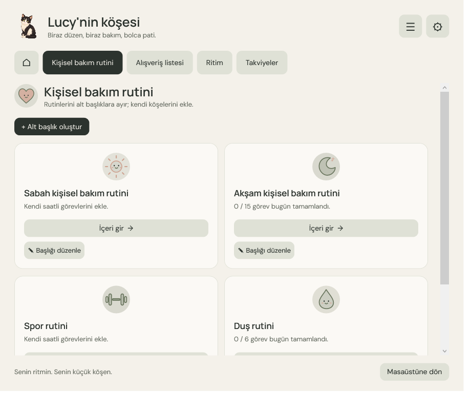
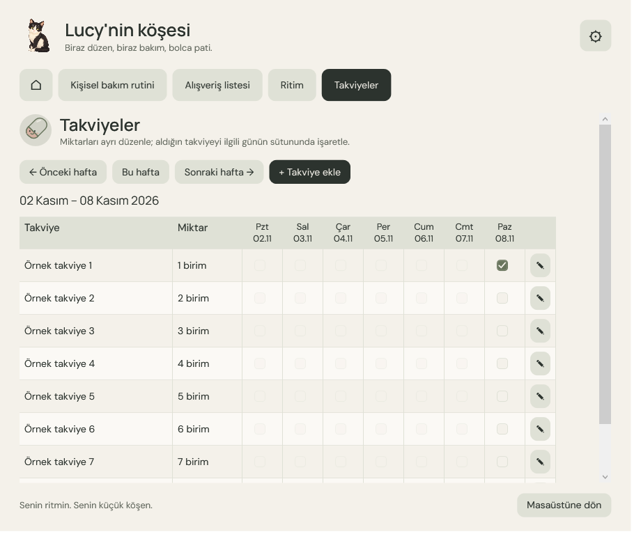

# Lucy 🐾

**Masaüstünde küçük bir dost, gününde sana ait bir köşe.**

Lucy, Windows için animasyonlu bir masaüstü maskotu ve kişisel takip uygulamasıdır. Hatırlatmalar, görevler, alışveriş listeleri, su ve kahve günlüğü ile ölçümler tek bir yerde buluşur.

## Lucy ile tanış

### Gününe küçük bir başlangıç

Görevlerine, listelerine ve küçük molalarına ana ekrandan ulaş.

### Rutinlerine yer aç

Sabah, akşam, spor ve diğer bakım rutinlerini kendi ihtiyaçlarına göre düzenle.

### Listelerin yanında olsun

Alışveriş listeleri oluştur, ürün ve miktar ekle; aldıklarını işaretle.

### Haftanı takip et

Takviyelerini ve miktarlarını kaydet, haftalık tabloda işaretle.

> Görseller, uygulamanın test modunda oluşturulmuş örnek veriler içerir.

## Başlarken

1. Bu depoyu indir ve dosyaları aynı klasöre çıkar.
2. Windows'ta `Lucy.exe` dosyasını aç. .NET Framework 4.7.2 veya üzeri gereklidir.
3. Masaüstü ve Windows başlangıcı için kısayollar istersen PowerShell'de `./Kur.ps1` komutunu çalıştır.
4. Kaynak koddan derlemek için aynı klasörde `./Derle.ps1` komutunu çalıştır.

İlk açılışta boş bir profil oluşturulur. Kayıtlar uygulama klasöründeki `data` dizinine, oluşturduğun raporlar `Raporlar` dizinine yazılır. Her iki dizin de Git dışında tutulur.

Masaüstü hareketleri ve günlük takip için [kullanım rehberine](Beni%20oku.md) göz atabilirsin.
